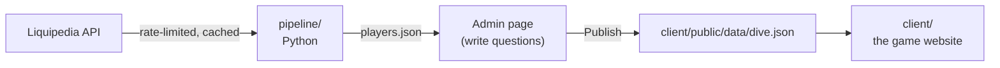

# Krilljoy

**A daily Valorant trivia game where the obvious answer loses.**
Name a pro player, a Sheriff skin, an agent. The rarer your valid answer, the deeper you dive.

Pro-scene answers are backed by [Liquipedia](https://liquipedia.net/valorant/)
data (CC BY-SA 3.0); game-content answers (agents, skins, maps, callouts) come
from [valorant-api.com](https://valorant-api.com).

## How it works



- **The pipeline** (`pipeline/`) pulls tier 1 rosters, countries, and
  international winners from Liquipedia's API, following its rate limits and
  caching every response.
- **The admin page** (`pipeline/admin.py`) is a local page for writing questions
  from dropdowns, with a live preview of every valid answer and its rarity tier.
- **The game** (`client/`) only reads the published `dive.json`. It never
  calls Liquipedia.

## Running it on your computer

You need [Python 3.10+](https://python.org).

```powershell
pip install -r pipeline/requirements.txt
copy pipeline\local_settings.example.py pipeline\local_settings.py
# edit pipeline/local_settings.py: replace CHANGE_ME with your contact

python pipeline/build.py     # first run ~10–15 min (Liquipedia rate limits), then seconds
python pipeline/admin.py     # opens the question editor at http://localhost:8765
```

## Playing the game on your computer

You need [Node.js 22+](https://nodejs.org) (the same one ERS uses).

```powershell
cd client
npm install        # first time only
npm run dev        # opens the game at http://localhost:5173
```

The game reads `client/public/data/dive.json`, so publish questions first
(`python pipeline/build.py`, or **Publish to game** in the admin page).
Progress and stats are saved in your browser. To replay today's dive while
testing, open the browser console (F12) and run `localStorage.clear()`.

### Putting it online (Cloudflare Pages, like ERS)

Create a Pages project from the GitHub repo with:

| Setting | Value |
|---|---|
| Root directory | `client` |
| Build command | `npm run build` |
| Build output directory | `dist` |
| Environment variable | `NODE_VERSION` = `22` |

Every push to `main` then updates the site, including new questions.

## Writing questions

1. Run `python pipeline/admin.py`.
2. **+ New question**, type it, and pick where answers come from: pro players,
   pro teams, agents, abilities, weapons, weapon skins, maps, map callouts, or a
   hand-written list.
3. Add conditions. Pro players: played for a team, from a country, won or played
   at an event, was IGL, was finals MVP. Teams: played at or won an event. Game
   content: e.g. weapon is Stinger, collection is Reaver, map is Ascent, role is
   Controller, ability does damage, skin is bought with VP. Answers must match all
   of them. For a hand-written list, type one answer per line, most obvious
   first (add other spellings after a `|`).
4. The preview lists every valid answer, most obvious first, with its tier and
   the Liquipedia evidence. Change a tier to override it.
5. **Publish to game** writes `client/public/data/dive.json`.

## Which questions play on which day

`pipeline/schedule.json` holds the 7 questions for each day. Every build or
**Publish to game** plans the next 30 days automatically: 3–4 pro-scene
questions a day, the least recently used first, no repeats for about two weeks.
Past days and today never change.

In the admin page, switch to **Schedule** to see the plan, and use **Pick
questions** on any future day to choose its questions yourself (that day is
then "hand-picked" and stays as you set it). The question list shows when each
question was last used and when it's next planned.

## Nightly rebuild (GitHub Actions)

`.github/workflows/nightly.yml` runs `build.py` on GitHub every night: fresh
Liquipedia and game data, ranks recalculated for the new date, the schedule
extended, and the result pushed. Cloudflare then updates the live game.

One-time setup: on GitHub open the repo's **Settings → Secrets and variables →
Actions → New repository secret**, name it `LIQUIPEDIA_USER_AGENT`, and paste
the same text as `USER_AGENT` in your `pipeline/local_settings.py`. To run it
right away: **Actions → Nightly rebuild → Run workflow**.

Because GitHub now commits too, run `git pull` before you start working
(`Edit questions.bat` does it for you). If `git push` ever says "rejected",
run `git pull`, then push again.

## Scoring

| Tier | Points |
|---|---|
| Silver | 10 |
| Gold (too clever) | 15 |
| Platinum | 30 |
| Diamond | 60 |
| Immortal | 85 |
| Radiant | 100 |

Like Krillion, rarity is estimated ahead of time, not from live answers. Every
possible answer has a fame rating (`pipeline/familiarity.json`, estimated by
Claude, with stat-based fallbacks). Newer things count as better known. Within a question,
answers are sorted from most to least obvious, then split: Silver 22%,
Platinum 30%, Diamond 28%, Immortal 20%, and the single rarest answer is
Radiant. Every question needs at least 8 valid answers.

**Tier 1** means appearing on a roster at a VCT international event (Masters,
Champions, LOCK//IN) or a franchised VCT league event (2023 onward).

## Project structure

```
krilljoy/
├── pipeline/
│   ├── build.py          Fetch data and rebuild answer banks
│   ├── admin.py/.html    Question editor
│   ├── prompts.json      The questions
│   ├── data.py           Events, rosters, winners → data/players.json
│   ├── prompts.py        Conditions, fame score, tiers
│   ├── liquipedia.py     Rate-limited, cached Liquipedia client
│   ├── game.py           Agents, skins, maps, callouts → data/game.json
│   ├── valorant_api.py   Cached valorant-api.com client
│   └── extract.py        Reads Liquipedia templates and HTML
├── client/               The game website (React + TypeScript + Vite)
│   ├── public/data/dive.json   Answer banks, written by the pipeline
│   └── src/
│       ├── game/         Rules: daily pick, answer matching, saving, sharing
│       ├── components/   Ocean, depth gauge, HUD, pixel sprites
│       └── screens/      Home, question, reveal, results, pop-ups
└── CLAUDE.md             Project brief for Claude Code
```

## Data and credit

Data from Liquipedia, licensed CC BY-SA 3.0. All requests follow the
[Liquipedia API Terms of Use](https://liquipedia.net/api-terms-of-use).
Inspired by the daily rare-answer game Krillion.

## Author

**Richard Weng**: Mechanical Engineering, Georgia Tech
[LinkedIn](https://linkedin.com/in/richardwweng)
