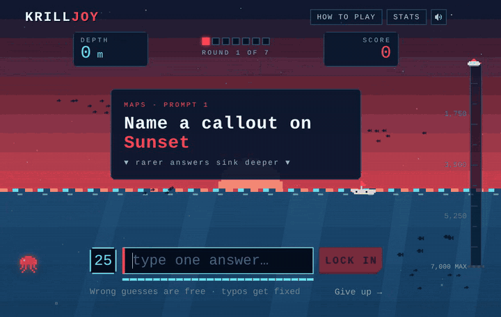
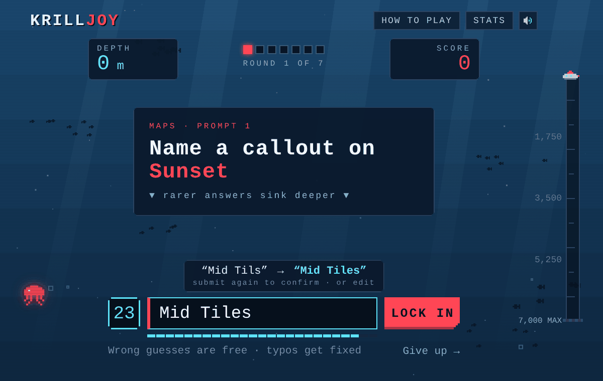
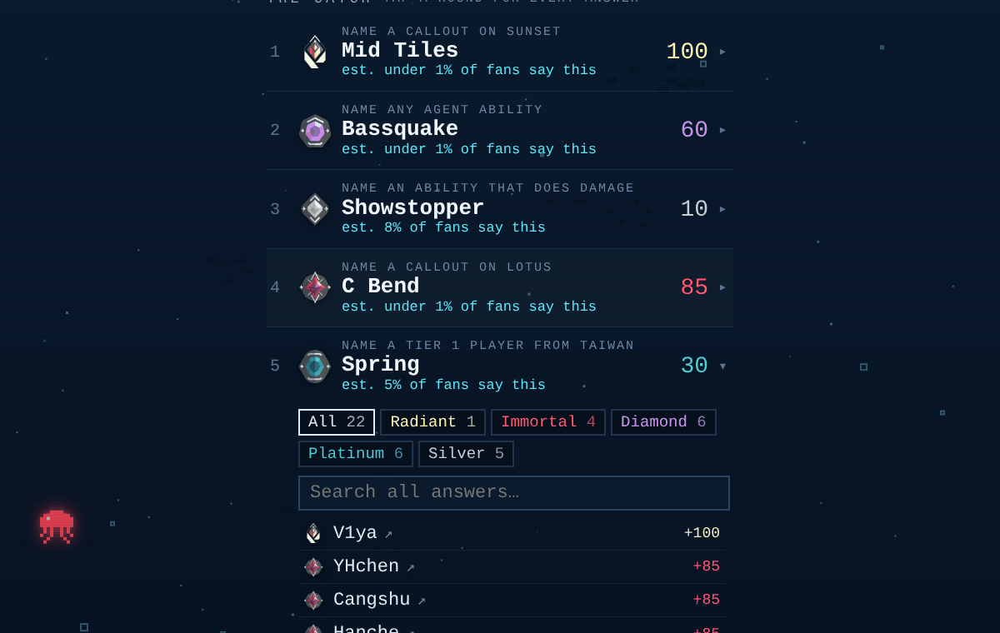
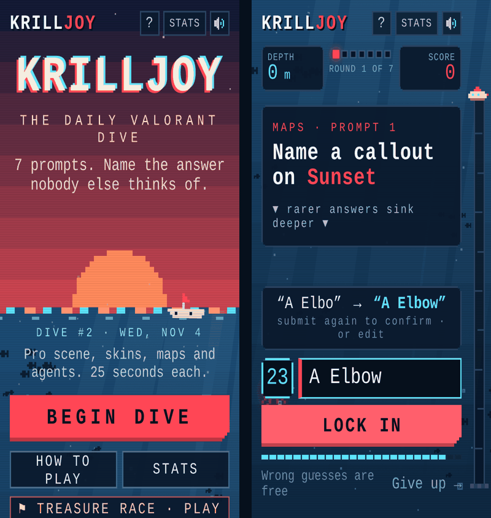
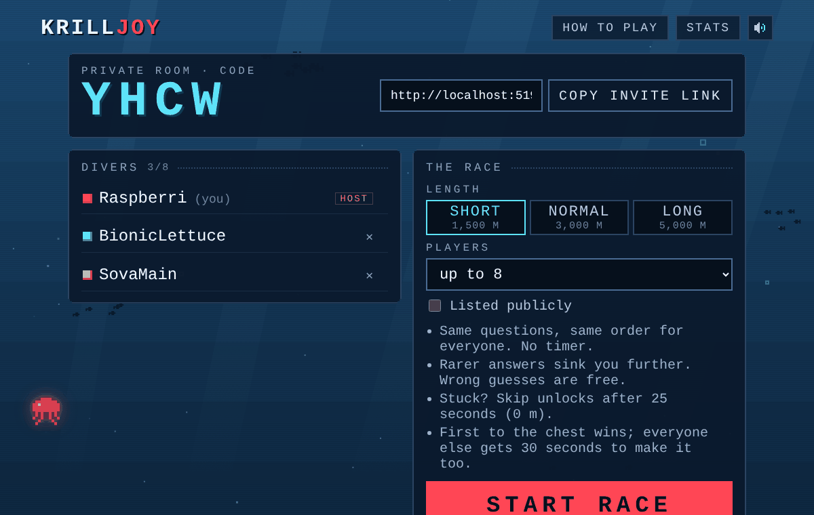
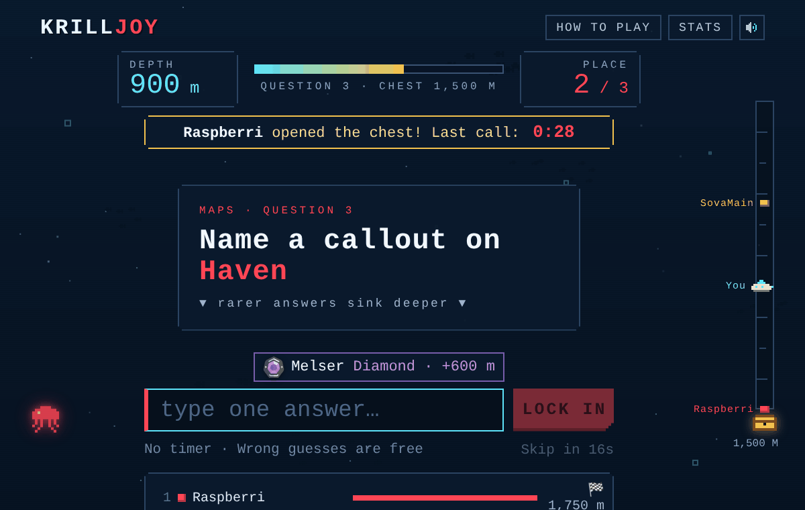
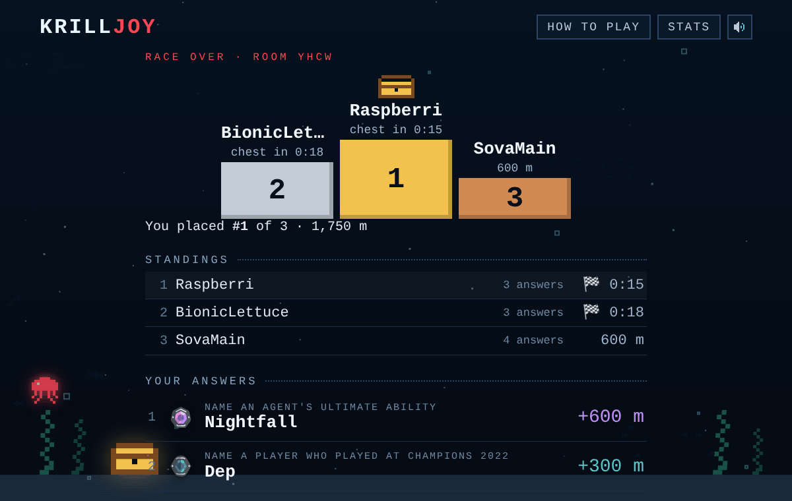
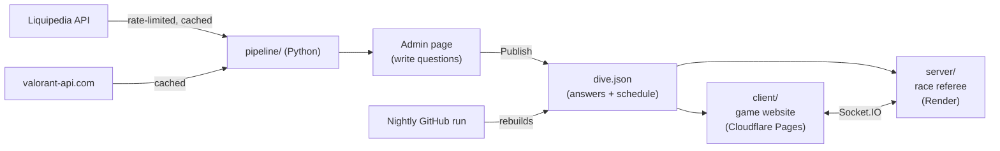

# Krilljoy

**A daily Valorant trivia game where the obvious answer loses.**
Name a pro player, a Sheriff skin, a callout on Lotus. Any valid answer
counts, but the rarer it is, the deeper you dive.

### ▶ Play at **[krilljoy.pages.dev](https://krilljoy.pages.dev)**



---

## Two ways to play

### Daily dive (solo)

- **7 prompts a day**, the same for everyone, new at midnight Eastern. A mix
  of the pro scene ("Name a tier 1 player from Canada") and the game itself
  ("Name an ability that does damage").
- **25 seconds each.** Wrong guesses are free: keep typing until one is valid.
- **Rarer answers sink deeper.** Every answer has a rank, from Silver (the one
  everybody says) up to Radiant (the single rarest answer).
- **Typos get fixed**, Krillion-style: the box fills in the real name and you
  press Enter again to confirm.
- **The end screen** shows your dive log, how you did, a shareable emoji grid,
  and "the catch": every valid answer for each prompt, rarest first.

| Typo? It asks first | Every answer, rarest first | On a phone |
|---|---|---|
|  |  |  |

### Treasure race (multiplayer)


- **Same questions, same order** for everyone in the room, back to back.
  **No timer**: lock in a valid answer and the next one appears.
- **Rarer answers sink you faster.** First diver to reach the treasure chest
  wins. Everyone else gets a **30-second last call**; after that, places go by
  depth.
- **Stuck?** Skip unlocks after 25 seconds (0 m).
- **Watch everyone dive live** on the shared gauge and leaderboard.
- **Getting in:** Quick play (a public lobby that starts 30 seconds after it
  fills up), Host a room (4-letter code + invite link), or join by code. The
  host picks the length: Short 1,500 m, Normal 3,000 m, Long 5,000 m.

| Lobby | Last call | Podium |
|---|---|---|
|  |  |  |

## Ranks

| Rank | Points (daily) | Depth (race) | Meaning |
|---|---|---|---|
| Silver | 10 | 100 m | The answer everyone blurts out |
| Gold | 15 | 150 m | The "obscure" pick everyone thinks of (set by hand) |
| Platinum | 30 | 300 m | Common, but not the first thought |
| Diamond | 60 | 600 m | Most people won't think of it |
| Immortal | 85 | 850 m | Real knowledge |
| Radiant | 100 | 1,000 m | The rarest answer. Almost nobody finds it |

Like Krillion, rarity is estimated ahead of time, not from live answers. Every
possible answer has a fame rating (`pipeline/familiarity.json`, with stat-based
fallbacks), and newer things count as better known. Within a question the
answers are sorted from most to least obvious, then split: Silver 22%,
Platinum 30%, Diamond 28%, Immortal 20%, and the single rarest is Radiant.
Every question needs at least 8 valid answers.

**Tier 1** means appearing on a roster at a VCT international (Masters,
Champions, LOCK//IN) or a franchised VCT league event (2023 onward).

---

## How it works



- **The pipeline** (`pipeline/`) pulls tier 1 rosters, countries, winners, IGLs
  and MVPs from Liquipedia's API (following its rate limits and caching every
  response), plus agents, abilities, weapons, skins, maps and callouts from
  valorant-api.com.
- **The admin page** (`pipeline/admin.py`) is a local page for writing
  questions from dropdowns, with a live preview of every valid answer and its
  rank, and a 30-day schedule.
- **The game** (`client/`) reads the published `dive.json`. It never calls
  Liquipedia.
- **The race server** (`server/`) runs the rooms and checks every race answer
  with the same matching rules as the daily game (`shared/match.ts`).
- **Every night** a GitHub Action rebuilds the data and pushes it; Cloudflare
  and Render then redeploy on their own. New skins, maps and pro players show
  up within about a week without anyone touching anything.

## Day to day

**Adding or changing questions:** double-click `Edit questions.bat` (it pulls
the latest first and opens the editor at http://localhost:8765). Add or edit
questions, press **Publish to game**, close the tab, then push:

```powershell
git add -A
git commit -m "Update questions"
git push
```

Treasure race uses new questions right away. The daily dive plans 30 days
ahead, so to see a new question sooner, put it on a day in the **Schedule** tab.

**Always `git pull` before starting work**: the nightly run pushes to the same
repo. If `git push` ever says "rejected", run `git pull`, then push again.

**When a new agent comes out**, its abilities need tagging (flash, smoke, wall,
heal, info, damage) in `ability_tags` in `pipeline/familiarity.json`, or they
won't count for "Name a flash ability"-style questions. Everything else updates
by itself.

## Running it on your computer

You need [Python 3.10+](https://python.org) and [Node.js 22+](https://nodejs.org).

**The pipeline and question editor** (from the `krilljoy` folder):

```powershell
pip install -r pipeline/requirements.txt
copy pipeline\local_settings.example.py pipeline\local_settings.py
# edit pipeline/local_settings.py: replace CHANGE_ME with your contact

python pipeline/build.py     # first run ~10–15 min (Liquipedia rate limits), then seconds
python pipeline/admin.py     # question editor at http://localhost:8765
```

**The game and the race server**, each in its own terminal:

```powershell
cd server            # terminal 1: race server on http://localhost:3001
npm install
npm run dev
```

```powershell
cd client            # terminal 2: the game on http://localhost:5173
npm install
npm run dev
```

Open http://localhost:5173/race in two tabs to race yourself: on localhost
each tab is its own player. To replay today's dive while testing, open the
browser console (F12) and run `localStorage.clear()`.

## Hosting

| | Where | Settings |
|---|---|---|
| Game | Cloudflare Pages, **https://krilljoy.pages.dev** | Root directory `client` · build `npm run build` · output `dist` · env `NODE_VERSION=22`, `VITE_SERVER_URL=https://krilljoy-race.onrender.com` |
| Race server | Render (free), **https://krilljoy-race.onrender.com** | Root Directory **empty** · build `cd server && npm install` · start `cd server && npm start` · env `NODE_VERSION=22`, `CLIENT_ORIGIN=https://krilljoy.pages.dev` |
| Keep-awake | UptimeRobot | HTTP check on `https://krilljoy-race.onrender.com/health` every 5 minutes |

- Every push to `main` (including the nightly one) redeploys both. A server
  redeploy ends any race in progress; the nightly one runs around 3 AM Eastern.
- Render's Root Directory stays empty on purpose: set to `server`, Render would
  only redeploy when server code changes and would miss the nightly answers.
- `VITE_SERVER_URL` is built into the site, so after changing it, use
  **Deployments → Retry deployment** in Cloudflare.
- The link preview (Discord, iMessage…) is `client/public/og.png` plus the
  `og:` tags in `client/index.html`.

## Which questions play on which day

`pipeline/schedule.json` holds the 7 questions for each day. Every build or
**Publish to game** plans the next 30 days: 3–4 pro-scene questions a day, at
most 2 of the same kind (skins, callouts…), the least recently used first, and
no repeats for about two weeks. Past days and today never change; days you
pick by hand in the **Schedule** tab stay as you set them.

## Nightly rebuild (GitHub Actions)

`.github/workflows/nightly.yml` runs `build.py` every night: fresh Liquipedia
and game data (anything older than a week is re-downloaded), ranks recalculated
for the new date, the schedule extended, and the result pushed.

One-time setup: the repo's **Settings → Secrets and variables → Actions** needs
a secret named `LIQUIPEDIA_USER_AGENT` with the same text as `USER_AGENT` in
`pipeline/local_settings.py`. To run it right away: **Actions → Nightly
rebuild → Run workflow**.

## Project structure

```
krilljoy/
├── pipeline/
│   ├── build.py          Fetch data and rebuild answer banks
│   ├── admin.py/.html    Question editor + schedule
│   ├── prompts.json      The questions
│   ├── schedule.json     Which questions play on which day
│   ├── familiarity.json  Fame ratings, nicknames, ability tags, known IGLs
│   ├── prompts.py        Conditions, fame score, ranks
│   ├── schedule.py       30-day planner
│   ├── data.py           Events, rosters, winners → data/players.json
│   ├── liquipedia.py     Rate-limited, cached Liquipedia client
│   ├── game.py           Agents, skins, maps, callouts → data/game.json
│   ├── valorant_api.py   Cached valorant-api.com client
│   └── extract.py        Reads Liquipedia templates and HTML
├── client/               The game website (React + TypeScript + Vite)
│   ├── public/data/dive.json   Answer banks, written by the pipeline
│   └── src/
│       ├── game/         Daily rules: picking, saving, sharing, sounds
│       ├── race/         Treasure race: lobby, rooms, race, results, rules
│       ├── components/   Ocean, depth gauge, HUD, pixel sprites
│       └── screens/      Home, question, reveal, results, pop-ups
├── server/               Race server (Node + Socket.IO): rooms and referee
│   └── src/              index.ts (rooms), race.ts (rules), data.ts (answers)
├── shared/match.ts       Answer matching used by both the game and the server
├── docs/                 README images
└── CLAUDE.md             Project brief for Claude Code
```

## Data and credits

Made by **Raspberri** ([Richard Weng](https://linkedin.com/in/richardwweng)).
Thanks to BionicLettuce.

- Pro-scene data from [Liquipedia](https://liquipedia.net/valorant/), licensed
  CC BY-SA 3.0. All requests follow the
  [Liquipedia API Terms of Use](https://liquipedia.net/api-terms-of-use).
- Game data from [valorant-api.com](https://valorant-api.com).
- Inspired by the daily rare-answer game Krillion. All art and sounds here are
  original.

Krilljoy was created under Riot Games' "Legal Jibber Jabber" policy using
assets owned by Riot Games. Riot Games does not endorse or sponsor this project.
