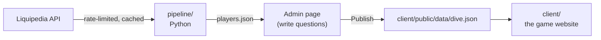

# Vallion

**A daily Valorant trivia game where the obvious answer loses.**
Name a pro player, a Sheriff skin, an agent. The rarer your valid answer, the deeper you dive.

Answers are backed by [Liquipedia](https://liquipedia.net/valorant/) data
(CC BY-SA 3.0).

## How it works



- **The pipeline** (`pipeline/`) pulls tier 1 rosters, countries, and
  international winners from Liquipedia's API, following its rate limits and
  caching every response.
- **The admin page** (`pipeline/admin.py`) is a local page for writing questions
  from dropdowns, with a live preview of every valid answer and its rarity tier.
- **The game** (`client/`, in progress) only reads the published `dive.json`. It
  never calls Liquipedia.

## Running it on your computer

You need [Python 3.10+](https://python.org).

```powershell
pip install -r pipeline/requirements.txt
copy pipeline\local_settings.example.py pipeline\local_settings.py
# edit pipeline/local_settings.py: replace CHANGE_ME with your contact

python pipeline/build.py     # first run ~10–15 min (Liquipedia rate limits), then seconds
python pipeline/admin.py     # opens the question editor at http://localhost:8765
```

## Writing questions

1. Run `python pipeline/admin.py`.
2. **+ New question**, type it, then add conditions: played for a team, never
   played for a team, from a country, won an international event, played at an
   event. Players must match all of them.
3. The preview lists every valid answer, most obvious first, with its tier and
   the Liquipedia evidence. Change a tier to override it.
4. **Publish to game** writes `client/public/data/dive.json`.

## Scoring

| Tier | Points |
|---|---|
| Plankton | 10 |
| Schooler | 30 |
| Rare | 60 |
| Deep Cut | 85 |
| One in a Krillion | 100 |
| Too Clever | 15 |

Each player gets a fame score from tier 1 events played, international
appearances and wins, and how recently they played. Answers are ranked and
split into tiers: the most obvious 15% are Plankton, the last 10% are One in a
Krillion.

**Tier 1** means appearing on a roster at a VCT international event (Masters,
Champions, LOCK//IN) or a franchised VCT league event (2023 onward).

## Project structure

```
vallion/
├── pipeline/
│   ├── build.py          Fetch data and rebuild answer banks
│   ├── admin.py/.html    Question editor
│   ├── prompts.json      The questions
│   ├── data.py           Events, rosters, winners → data/players.json
│   ├── prompts.py        Conditions, fame score, tiers
│   ├── liquipedia.py     Rate-limited, cached API client
│   └── extract.py        Reads Liquipedia templates and HTML
├── client/               The game website (coming next)
└── CLAUDE.md             Project brief for Claude Code
```

## Data and credit

Data from Liquipedia, licensed CC BY-SA 3.0. All requests follow the
[Liquipedia API Terms of Use](https://liquipedia.net/api-terms-of-use).
Inspired by the daily rare-answer game Krillion.

## Author

**Richard Weng**: Mechanical Engineering, Georgia Tech
[LinkedIn](https://linkedin.com/in/richardwweng)
